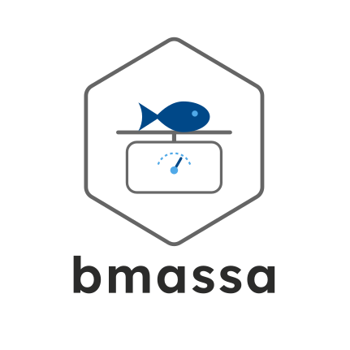

<!-- README.md is generated from README.Rmd. Edit README.Rmd and render it with rmarkdown::render("README.Rmd", output_format = rmarkdown::github_document(html_preview = FALSE)) after installing the package. -->

# *bmassa* 

<!-- badges: start -->

[](https://github.com/STABLE-uv/bmassa/actions/workflows/R-CMD-check.yaml)
[](https://lifecycle.r-lib.org/articles/stages.html#experimental)
<!-- badges: end -->

*bmassa* estimates the mean individual mass and the biomass of aquatic
taxa (phytoplankton, zooplankton, macroinvertebrates, fish and
amphibians, adults and tadpoles) from abundance data, with prediction
intervals. Hierarchical models fitted to published compilations and data
sets predict each taxon from its own reference data or, when it has
none, from its closest relatives, and the interval widens with the
substitution. All the estimates are in one currency: wet mass (mg) by
default, or dry mass, ash-free dry mass, carbon, nitrogen, phosphorus or
energy, converted from the currency of each model with the uncertainty
of the conversion factors.

## Installation

From GitHub, with its dependencies:

``` r
# install.packages("remotes")
remotes::install_github("STABLE-uv/bmassa", dependencies = TRUE)
```

*bmassa* needs R (\>= 3.6.0) and the R packages *stats* (R Core Team
2024) and *withr* (Hester et al. 2022). *curl* (Ooms 2023) and
*jsonlite* (Ooms 2014) are needed only by `standardize_taxa()`, which
queries the Catalogue of Life through the GBIF API.

## Example

Two tables: the taxon units (a taxon, or a taxon in one life stage and
sex, with its classification and its counting unit) and their abundances
by site (and date, if any). A third, optional table holds the lengths:
usually the mean length of a unit, and the lengths of individuals where
they were measured (one row per individual or per length class, with the
number of individuals `n`). A length without `site` applies to all the
samples of the unit, one with `site` to that site (and one with `date`,
to that sample), and each sample takes the most specific. Constructed
example data shipped with the package:

``` r
library(bmassa)
tx <- example_survey$taxa
ab <- example_survey$abundance
ln <- example_survey$lengths
tx[c(1, 8, 13, 19, 20), c("taxon_id", "broad_group", "genus", "species", "life_stage",
                          "count_unit")]
#>    taxon_id       broad_group      genus                 species life_stage count_unit
#> 1       t01     phytoplankton Cyclotella Cyclotella meneghiniana       <NA>       cell
#> 8       t08       zooplankton    Daphnia           Daphnia magna       <NA> individual
#> 13      t13 macroinvertebrate   Gammarus                    <NA>       <NA> individual
#> 19      t19         amphibian Pelophylax       Pelophylax perezi      adult individual
#> 20      t20         amphibian Pelophylax       Pelophylax perezi      larva individual
head(ab, 3)
#>   site taxon_id abundance per
#> 1   L1      t01      1800  mL
#> 2   L1      t02     25000  mL
#> 3   L1      t03       300  mL
ln
#>    taxon_id site length_mean length  n length_unit       length_type length_sd length_cv
#> 1       t08 <NA>         2.2     NA NA          mm       body_length        NA      0.25
#> 2       t10 <NA>        12.0     NA NA          mm       body_length         3        NA
#> 3       t11 <NA>         6.0     NA NA          mm       body_length        NA        NA
#> 4       t12 <NA>        16.0     NA NA          mm       body_length         3        NA
#> 5       t16 <NA>        15.0     NA NA          cm       fork_length         4        NA
#> 6       t19 <NA>        58.0     NA NA          mm snout_vent_length        NA      0.15
#> 7       t17   L1       110.0     NA NA          mm       fork_length        20        NA
#> 8       t17   L2        85.0     NA NA          mm       fork_length        15        NA
#> 9       t13   L1          NA      4  2          mm       body_length        NA        NA
#> 10      t13   L1          NA      6  4          mm       body_length        NA        NA
#> 11      t13   L1          NA      8  3          mm       body_length        NA        NA
#> 12      t13   L1          NA     10  2          mm       body_length        NA        NA
#> 13      t13   L1          NA     12  1          mm       body_length        NA        NA
```

Here the chub (`t17`) has a mean length in each site, and the *Gammarus*
(`t13`) of site L1 were measured by length class.

For your own list of names, `standardize_taxa()` returns this
classification and the identifier of each taxon (`col_id`) from the
Catalogue of Life (COL XR); it needs internet.

Before estimating, the taxonomic level from which each taxon will come,
and the factor by which the median is divided and multiplied to get its
95 % interval:

``` r
check_coverage(tx, ln)
#> <bmassa_coverage> 20 taxa, 23 rows (13 without lengths, 9 with lengths, 1 from typical lengths)
#>   phytoplankton      typical        species 4, genus 1; median factor 12
#>   zooplankton        typical        species 3; median factor 12
#>   zooplankton        length         species 1; median factor 2.6
#>   macroinvertebrate  typical        species 1, genus 1, family 1; median factor 14
#>   macroinvertebrate  length         species 2, genus 1, family 1; median factor 3
#>   fish               typical        species 1, genus 1; median factor 7.8
#>   fish               length         species 1, genus 2; median factor 1.4
#>   amphibian          typical_length family 1; median factor 15
#>   amphibian          length         species 1; median factor 1.7
#> Factor: the 95 % prediction interval is the median divided and multiplied by it.
```

The mean individual mass of a population of each taxon and the biomass
of each row, in wet mass (mg) by default. With lengths, the
back-transformation of the length-mass relations has to be chosen:
`"lognormal"` gives the mean mass of the individuals of each length,
which biomass needs:

``` r
est <- estimate_biomass(ab, tx, ln, bias_correction = "lognormal")
#> Warning in estimate_biomass(ab, tx, ln, bias_correction = "lognormal"): 3 of 40 rows were not
#> estimated; see the `reason` column of the result.
est
#> <bmassa_estimate> 40 rows: 37 estimated (14 from lengths, 23 without lengths), 3 not estimated
#> Lowest level shared with the reference: species 27, genus 6, family 4
#> Interval: prediction 95 %, for the mean individual mass of a population; bias_correction = "lognormal"
#> Currency: wet mass (mg); 30 rows converted from the currency of their models; habitat unknown
#> Not estimated:
#>     1  abundance is missing
#>     2  no conversion from dry mass to wet mass for tadpoles (the reference has their carbon, nitrogen and phosphorus only)
#> Use as.data.frame() for the table and summarize_biomass() for totals.
e <- as.data.frame(est)
print(e[e$site == "L1", c("taxon_id", "method", "match_level", "length_mm", "ind_median",
                          "ind_lower", "ind_upper", "unit")], digits = 3)
#>    taxon_id         method match_level length_mm ind_median ind_lower ind_upper unit
#> 1       t01        typical     species        NA   2.80e-06  2.51e-07  3.12e-05   mg
#> 2       t02        typical     species        NA   1.11e-07  1.03e-08  1.19e-06   mg
#> 3       t03        typical       genus        NA   1.00e-06  4.79e-08  2.09e-05   mg
#> 4       t04        typical     species        NA   5.49e-08  4.55e-09  6.62e-07   mg
#> 5       t05        typical     species        NA   1.01e-07  8.55e-09  1.20e-06   mg
#> 6       t06        typical     species        NA   2.18e-04  1.86e-05  2.56e-03   mg
#> 7       t07        typical     species        NA   8.53e-04  7.19e-05  1.01e-02   mg
#> 8       t08         length     species      2.20   4.85e-01  1.44e-01  1.63e+00   mg
#> 9       t09        typical     species        NA   4.18e-02  2.97e-03  5.88e-01   mg
#> 10      t10         length     species     12.00   3.30e+00  1.01e+00  1.07e+01   mg
#> 11      t11         length     species      6.00   3.27e+00  7.64e-01  1.40e+01   mg
#> 12      t12         length      family     16.00   6.65e+01  1.20e+01  3.68e+02   mg
#> 13      t13         length       genus      7.98   3.49e+00  9.80e-01  1.24e+01   mg
#> 14      t14        typical      family        NA   2.66e+00  7.11e-02  9.95e+01   mg
#> 15      t15        typical     species        NA   1.23e+00  8.99e-02  1.68e+01   mg
#> 16      t16         length     species    150.00   5.55e+04  4.57e+04  6.75e+04   mg
#> 17      t17         length       genus    110.00   2.02e+04  1.48e+04  2.77e+04   mg
#> 18      t18        typical     species        NA   4.45e+02  5.70e+01  3.48e+03   mg
#> 19      t19         length     species     58.00   2.32e+04  1.35e+04  3.97e+04   mg
#> 20      t20 typical_length      family     54.65         NA        NA        NA <NA>
```

In another currency, here carbon in µg, with the uncertainty of the
conversion factors (adult amphibians have too few factors in the
reference data: they go to dry mass and energy with the values of frogs
and toads of US EPA 1993, but not to carbon; tadpoles, estimated in dry
mass, go to carbon, nitrogen and phosphorus, but not to wet mass).
`estimate_biomass(ab, tx, ln, bias_correction = "lognormal", currency = "carbon", unit = "ug")`
gives the same:

``` r
est_c <- convert_currency(est, to = "carbon", unit = "ug")
#> Warning in convert_currency.bmassa_estimate(est, to = "carbon", unit = "ug"): 2 of 40 rows could
#> not be converted to carbon; see the `reason` column of the result.
ec <- as.data.frame(est_c)
print(ec[ec$site == "L1", c("taxon_id", "converted_from", "ind_median", "ind_lower",
                            "ind_upper", "unit")], digits = 3)
#>    taxon_id converted_from ind_median ind_lower ind_upper unit
#> 1       t01      biovolume   1.80e-04  2.55e-05  1.27e-03   ug
#> 2       t02      biovolume   1.80e-05  1.93e-06  1.67e-04   ug
#> 3       t03      biovolume   1.42e-04  8.18e-06  2.47e-03   ug
#> 4       t04      biovolume   9.29e-06  8.97e-07  9.63e-05   ug
#> 5       t05      biovolume   1.65e-05  1.62e-06  1.68e-04   ug
#> 6       t06       dry_mass   8.26e-03  6.85e-04  9.95e-02   ug
#> 7       t07       dry_mass   2.98e-02  2.47e-03  3.59e-01   ug
#> 8       t08       dry_mass   2.73e+01  1.00e+01  7.41e+01   ug
#> 9       t09       dry_mass   2.82e+00  2.30e-01  3.45e+01   ug
#> 10      t10       dry_mass   1.89e+02  6.86e+01  5.21e+02   ug
#> 11      t11       dry_mass   3.11e+02  9.52e+01  1.02e+03   ug
#> 12      t12       dry_mass   6.89e+03  1.54e+03  3.08e+04   ug
#> 13      t13       dry_mass   2.33e+02  7.66e+01  7.10e+02   ug
#> 14      t14       dry_mass   1.85e+02  5.52e+00  6.18e+03   ug
#> 15      t15       dry_mass   7.54e+01  5.96e+00  9.54e+02   ug
#> 16      t16       wet_mass   6.01e+06  3.66e+06  9.87e+06   ug
#> 17      t17       wet_mass   2.12e+06  1.14e+06  3.92e+06   ug
#> 18      t18       wet_mass   4.88e+04  5.78e+03  4.11e+05   ug
#> 19      t19           <NA>         NA        NA        NA <NA>
#> 20      t20       dry_mass   5.37e+04  3.52e+03  8.21e+05   ug
```

Totals by site and group, by simulation with shared draws: two taxa
estimated from the same family, or the same taxon in two sites, have
correlated errors:

``` r
tot <- summarize_biomass(est_c, by = c("site", "broad_group"), na_rm = TRUE, seed = 1)
print(tot[, c("site", "broad_group", "biomass_unit", "biomass_mean", "biomass_lower",
              "biomass_upper", "n_missing")], digits = 3)
#>    site       broad_group biomass_unit biomass_mean biomass_lower biomass_upper n_missing
#> 1    L1         amphibian    ug/100 m2     4.24e+06      1.13e+05      2.29e+07         1
#> 2    L1              fish    ug/100 m2     4.88e+07      3.17e+07      7.24e+07         0
#> 3    L1 macroinvertebrate        ug/m2     3.19e+05      1.20e+05      8.11e+05         0
#> 4    L1     phytoplankton        ug/mL     1.70e+00      2.94e-01      5.91e+00         0
#> 5    L1       zooplankton         ug/L     2.98e+02      7.77e+01      1.14e+03         0
#> 6    L2         amphibian    ug/100 m2     7.78e+06      2.07e+05      4.20e+07         1
#> 7    L2              fish    ug/100 m2     4.47e+07      2.93e+07      7.03e+07         0
#> 8    L2 macroinvertebrate        ug/m2     3.03e+05      9.19e+04      1.01e+06         0
#> 9    L2     phytoplankton        ug/mL     1.98e+00      2.76e-01      7.56e+00         0
#> 10   L2       zooplankton         ug/L     1.01e+02      8.45e+00      5.17e+02         1
```

The size structure of each sample: the mean and median mass of the
individuals, weighted by their abundances, and the shares of the
individuals and of the biomass in size classes, with the share of
individuals without a size; taxa known only by their mean size make the
median and the classes approximations (`approximation`):

``` r
sz <- summarize_size(est, by = c("site", "broad_group"), seed = 1)
print(as.data.frame(sz)[, c("site", "broad_group", "mean_size", "median_size",
                            "share_excluded", "approximation")], digits = 3)
#>    site       broad_group mean_size median_size share_excluded approximation
#> 1    L1         amphibian  2.36e+04    2.12e+04          0.882         FALSE
#> 2    L1              fish  7.92e+03    4.32e+02          0.000          TRUE
#> 3    L1 macroinvertebrate  4.37e+00    2.34e+00          0.000          TRUE
#> 4    L1     phytoplankton  3.42e-07    1.12e-07          0.000          TRUE
#> 5    L1       zooplankton  7.87e-03    2.15e-04          0.000          TRUE
#> 6    L2         amphibian  2.36e+04    2.12e+04          0.965         FALSE
#> 7    L2              fish  4.95e+03    4.32e+02          0.000          TRUE
#> 8    L2 macroinvertebrate  3.38e+00    1.24e+00          0.000          TRUE
#> 9    L2     phytoplankton  1.86e-07    1.12e-07          0.000          TRUE
#> 10   L2       zooplankton        NA          NA             NA            NA
```

The draws themselves, for models that use the biomass of every taxon
(such as the energy fluxes of a food web): the mean individual mass and
the biomass of every row in every draw, with the same shared errors as
the totals. Here all the groups per square metre of each site
(`convert_abundance()`, from the depth of each site), so that they can
be added up, with the populations of each habitat apart
(`population_by`):

``` r
sites <- data.frame(site = c("L1", "L2"), depth = c(1.5, 0.8), depth_unit = "m")
ab_m2 <- convert_abundance(ab, to = "m2", sites = sites)
ab_m2$habitat <- ifelse(ab_m2$site == "L1", "lake", "spring")
est_w <- estimate_biomass(ab_m2, tx, ln, bias_correction = "lognormal")
sim <- simulate(est_w, nsim = 1000, seed = 1, population_by = "habitat")
d <- as.data.frame(sim, draws = 1:2)
print(head(d[, c("draw", "site", "taxon_id", "habitat", "ind_mass", "biomass",
                 "biomass_unit")]), digits = 3)
#>   draw site taxon_id habitat ind_mass biomass biomass_unit
#> 1    1   L1      t01    lake 3.47e-06 9380.43        mg/m2
#> 2    1   L1      t02    lake 3.07e-08 1150.78        mg/m2
#> 3    1   L1      t03    lake 1.32e-07   59.40        mg/m2
#> 4    1   L1      t04    lake 4.86e-08  656.27        mg/m2
#> 5    1   L1      t05    lake 1.59e-08   14.33        mg/m2
#> 6    1   L1      t06    lake 1.00e-05    5.27        mg/m2
```

## Methods and decisions

- The models were fitted with the R package *lme4* (Bates et al. 2015)
  to the reference data (one per domain and kind of data): masses
  without lengths with nested random effects by taxonomic level,
  length-mass relations with random intercepts and slopes by level and
  length type, and conversion factors between currencies with nested
  random effects. The package predicts from their tables with base R;
  `get_reference()` returns them.
- A taxon is matched by its `col_id`, if given, and otherwise by name
  and rank, from its lowest rank upwards, to the taxonomy of the
  Catalogue of Life (COL XR) used for the reference.
- The interval is for the mean individual mass of a population of the
  taxon: it includes the uncertainty of the model, of the taxonomic
  substitution and the variation between populations and between
  sources, but not the error of the abundances.
- The totals and `simulate()` share the errors of rows estimated from
  the same node of the reference, of the same population and of the same
  conversion factors; `simulate()` returns the draws of the totals, row
  by row.
- Insects without lengths and without a stage are taken as larvae, and
  copepods as adults (their copepodites and nauplii are fixed
  contrasts); fish without lengths are estimated as whole populations
  (all sizes), with wide intervals; amphibians without a stage are taken
  as larvae (tadpoles, in frogs and toads), and adults must be declared.
- Phytoplankton counted in natural units takes the natural units of the
  reference, often single cells or small groups in colonial genera; give
  `cells_per_unit` for colonies counted whole.
- Lengths outside those of the reference relations of a taxon use its
  closest relative that covers them, and are not extrapolated unless
  `extrapolate = TRUE`.
- With the lengths of individuals, the mean mass is the mean of their
  masses, without assuming a distribution of lengths; with a mean
  length, its spread (`length_sd` or `length_cv`) corrects the mass of
  the mean length, smaller than the mean mass.
- The models predict phytoplankton biovolume, the dry mass of
  invertebrates and tadpoles and the wet mass of fish and adult
  amphibians; every row is then converted to the currency asked for,
  with the conversion models (a row that cannot reach it is not
  estimated, with the reason).
- The vignettes: `vignette("bmassa")` goes through the workflow and the
  decisions, `vignette("tuesday-lake")` compares the predictions with
  the masses and biomasses measured in Tuesday Lake, and
  `vignette("azoxystrobin")` goes from the raw counts of a mesocosm
  experiment (Amador et al. 2024) to the effect of a fungicide on
  biomass, with a generalized linear mixed model. The cross-validation
  of the intervals is in the source repository
  (`dev/validation/cross_validation.md`).

## Data sources

``` r
s <- cite_sources()
knitr::kable(s[, c("source_id", "citation", "licence")])
```

| source_id          | citation                                                                                                                                                                                                                                                                                                                                | licence                                                                                                                                 |
|:-------------------|:----------------------------------------------------------------------------------------------------------------------------------------------------------------------------------------------------------------------------------------------------------------------------------------------------------------------------------------|:----------------------------------------------------------------------------------------------------------------------------------------|
| abuturab2017       | Abu Turab MQM, Al-Qarooni IHM, Al-Saad HT (2017). \[Assessment of the ability of two species of freshwater snails to accumulate some elements in their biomass and shells; in Arabic\]. University of Thi-Qar Journal of Science 6(2), 25-35.                                                                                           | Values transcribed from the paper                                                                                                       |
| arranz2022         | Arranz I, Brucet S, Bartrons M, García-Comas C, Alcaraz C, Bardina M, Navarro Barquero P, Casals F, Caiola N, Duran MC, García-Berthou E, Maceda-Veiga A, Munné A, Rodríguez-Pérez MJ, Solà C, de Sostoa A, Benejam L (2022). Individual body mass and length dataset for over 12,000 fish from Iberian streams. Data in Brief, 108248. | Zenodo record: Other (Open), with no further description; article in Data in Brief                                                      |
| baby2010           | Baby RL, Hasan I, Kabir KA, Naser MN (2010). Nutrient analysis of some commercially important molluscs of Bangladesh. Journal of Scientific Research 2, 390-396.                                                                                                                                                                        | Values transcribed from the paper                                                                                                       |
| back2013           | Back JA (2013). Effects of stream nutrient enrichment on aquatic insect stoichiometry: importance of life-history traits, sex, and ontogeny. Dissertation, Baylor University.                                                                                                                                                           | Values transcribed from the thesis                                                                                                      |
| baer2022           | Baer J, Spiessl C, Brinker A (2022). Size matters? Species- and size-specific fish predation on recently established invasive quagga mussels Dreissena rostriformis bugensis Andrusov 1897 in a large, deep oligotrophic lake. Journal of Fish Biology 100, 1272-1282.                                                                  | Values transcribed from the paper                                                                                                       |
| beck2022           | Beck M, Billoir E, Felten V, Meyer A, Usseglio-Polatera P, Danger M (2022). Data for: A database of West European headwater macroinvertebrate stoichiometric traits. Dryad.                                                                                                                                                             | CC0 1.0 (Dryad)                                                                                                                         |
| begam2002          | Begam S, Khan RA (2002). Population density, biomass and calorific values of freshwater bivalve, Parreysia favidens (Benson) of Kosi River Basin, North Bihar, India. Records of the Zoological Survey of India 100(3-4), 177-181.                                                                                                      | Values transcribed from the paper                                                                                                       |
| benke1999          | Benke AC, Huryn AD, Smock LA, Wallace JB (1999). Length-mass relationships for freshwater macroinvertebrates in North America with particular reference to the southeastern United States. Journal of the North American Benthological Society 18, 308-343.                                                                             | Values transcribed from the paper                                                                                                       |
| birge1922          | Birge EA, Juday C (1922). The inland lakes of Wisconsin. The plankton. I. Its quantity and chemical composition. Bulletin of the Wisconsin Geological and Natural History Survey 64, Scientific Series 13. Madison.                                                                                                                     | Values transcribed from the report (1922, scan in the Biodiversity Heritage Library)                                                    |
| bottrell1976       | Bottrell HH, Duncan A, Gliwicz ZM, Grygierek E, Herzig A, Hillbricht-Ilkowska A, Kurasawa H, Larsson P, Weglenska T (1976). A review of some problems in zooplankton production studies. Norwegian Journal of Zoology 24, 419-456.                                                                                                      | Values transcribed from the paper                                                                                                       |
| brey2010           | Brey T, Müller-Wiegmann C, Zittier ZMC, Hagen W (2010). Body composition in aquatic organisms - a global data bank of relationships between mass, elemental composition and energy content. Journal of Sea Research 64, 334-340.                                                                                                        | No licence stated                                                                                                                       |
| cadses_boxcorer    | Rosati I, Basset A (2020). Benthic macroinvertebrates communities data collected in 15 coastal lagoons of Mediterranean and Black sea. LifeWatch Italy.                                                                                                                                                                                 | CC BY 4.0 (LifeWatch Italy; EML metadata of the download)                                                                               |
| cadses_leafpack    | Rosati I, Basset A (2021). Benthic macroinvertebrates communities data collected in 15 coastal lagoons of Mediterranean and Black sea by using the leaf pack technique. LifeWatch Italy.                                                                                                                                                | CC BY-NC 4.0 (LifeWatch Italy)                                                                                                          |
| calow1974          | Calow P, Jennings JB (1974). Calorific values in the phylum Platyhelminthes: the relationship between potential energy, mode of life and the evolution of entoparasitism. Biological Bulletin 147, 81-94.                                                                                                                               | Values transcribed from the paper                                                                                                       |
| cen2015            | CEN (2015). EN 16695:2015 Water quality - Guidance on the estimation of phytoplankton biovolume. European Committee for Standardization, Brussels.                                                                                                                                                                                      | Convention of the standard; no data used                                                                                                |
| ciancio2006        | Ciancio JE, Pascual MA (2006). Energy density of freshwater Patagonian organisms. Ecología Austral 16, 91-94.                                                                                                                                                                                                                           | Values transcribed from the paper                                                                                                       |
| corman2026         | Corman JR, Halvorson HM, Brucker C, Costanza-Robinson MS, Edwards JH, Moody EK, Petersen C, et al. (2026). Limno-STOICH: a comprehensive database linking the elemental stoichiometry of organisms with inland aquatic habitats. Limnology and Oceanography Letters 11, e70105.                                                         | CC BY-NC 4.0 (EDI data package; the article is CC BY 4.0)                                                                               |
| coughlan2021       | Coughlan NE, Cunningham EM, Cuthbert RN, et al. (2021). Biometric conversion factors as a unifying platform for comparative assessment of invasive freshwater bivalves. Journal of Applied Ecology 58, 1945-1956.                                                                                                                       | CC0 1.0 (Dryad)                                                                                                                         |
| crichton2003       | Crichton CA (2003). Responses of the freshwater snail, Lymnaea peregra, to pollutants as an indicator of ecological water quality. Doctoral thesis, University of Stirling.                                                                                                                                                             | Values transcribed from the thesis                                                                                                      |
| culver1985         | Culver DA, Boucherle MM, Bean DJ, Fletcher JW (1985). Biomass of freshwater crustacean zooplankton from length-weight regressions. Canadian Journal of Fisheries and Aquatic Sciences 42, 1380-1390.                                                                                                                                    | Values transcribed from the paper                                                                                                       |
| cummins1971        | Cummins KW, Wuycheck JC (1971). Caloric equivalents for investigations in ecological energetics. Mitteilungen der Internationalen Vereinigung für Theoretische und Angewandte Limnologie 18, 1-158.                                                                                                                                     | Values transcribed from the paper                                                                                                       |
| doherty1986        | Doherty FG (1986). A multidisciplinary study of the Asiatic clam, Corbicula fluminea, from the New River, Virginia. Doctoral dissertation, Virginia Polytechnic Institute and State University.                                                                                                                                         | Values transcribed from the thesis                                                                                                      |
| dumont1975         | Dumont HJ, Van de Velde I, Dumont S (1975). The dry weight estimate of biomass in a selection of Cladocera, Copepoda and Rotifera from the plankton, periphyton and benthos of continental waters. Oecologia 19, 75-97.                                                                                                                 | Values transcribed from the paper                                                                                                       |
| ejsmontkarabin1998 | Ejsmont-Karabin J (1998). Empirical equations for biomass calculation of planktonic rotifers. Polskie Archiwum Hydrobiologii 45, 513-522.                                                                                                                                                                                               | Values transcribed from the paper                                                                                                       |
| evangelista2024    | Evangelista C, Danger M, Lassus R, et al. (2024). Different impacts of diet composition on the stoichiometric traits of two freshwater species. Aquatic Ecology 58, 249-261.                                                                                                                                                            | Figshare data set (licence not checked)                                                                                                 |
| evanswhite2005     | Evans-White MA, Stelzer RS, Lamberti GA (2005). Taxonomic and regional patterns in benthic macroinvertebrate elemental composition in streams. Freshwater Biology 50, 1786-1799.                                                                                                                                                        | Values transcribed from the paper                                                                                                       |
| goedkoop2021       | Goedkoop W, Choudhury MI, Lau DCP, Grandin U (2021). Inverting nutrient fluxes across the land-water interface - Exploring the potential of zebra mussel (Dreissena polymorpha) farming. Journal of Environmental Management, 111889.                                                                                                   | Values transcribed from the paper                                                                                                       |
| gonzalez2018       | González AL, Céréghino R, Dézerald O, Farjalla VF, Leroy C, Richardson BA, Richardson MJ, Romero GQ, Srivastava DS (2018). Ecological mechanisms and phylogeny shape invertebrate stoichiometry: a test using detritus-based communities across Central and South America. Functional Ecology 32, 2448-2463.                            | CC0 1.0 (Dryad)                                                                                                                         |
| gonzalez2025       | González AL, Merder J, Andraczek K, et al. (2025). StoichLife: a global dataset of plant and animal elemental content. Scientific Data 12, 569.                                                                                                                                                                                         | CC0 1.0 (Dryad)                                                                                                                         |
| hasan2023          | Hasan MR, Rabbi MH, Karim MR, Karmakar D, Tasnim N, Islam SMR, Nabi MR (2023). Comparative analysis of nutritional profiles of Moina macrocopa cultured in different media: an investigation into the effects of culture media on aquatic organism nutrition. International Journal of Fisheries and Aquatic Studies 11(2), 114-122.    | Values transcribed from the paper                                                                                                       |
| hebert2016         | Hébert M-P, Beisner BE, Maranger R (2016). A compilation of quantitative functional traits for marine and freshwater crustacean zooplankton. Ecology 97, 1081.                                                                                                                                                                          | Copyright and proprietary restrictions: none (metadata of the data paper); cite the paper                                               |
| hrycik2024         | Hrycik AR, Burlakova LE, Karatayev AY, Daniel SE, Dermott R, Tarbell M, Hinchey EK (2024). A dataset of individual wet weights of benthic macroinvertebrates. Limnology and Oceanography Letters 9, 696-715.                                                                                                                            | CC0 1.0 (Dryad data); CC BY 4.0 (article, Table 3)                                                                                      |
| james1998          | James MR, Weatherhead M, Stanger C, Graynoth E (1998). Macroinvertebrate distribution in the littoral zone of Lake Coleridge, South Island, New Zealand—effects of habitat stability, wind exposure, and macrophytes. New Zealand Journal of Marine and Freshwater Research 32, 287-305.                                                | Values transcribed from the paper                                                                                                       |
| jensen2006         | Jensen TC, Anderson TR, Daufresne M, Hessen DO (2006). Does excess carbon affect respiration of the rotifer Brachionus calyciflorus Pallas? Freshwater Biology 51, 2320-2333.                                                                                                                                                           | Values transcribed from the paper                                                                                                       |
| kamler1969         | Kamler E (1969). A comparison of the closed-bottle and flowing-water methods for measurement of respiration in aquatic invertebrates. Polskie Archiwum Hydrobiologii 16, 31-49.                                                                                                                                                         | Values transcribed from the paper                                                                                                       |
| knapp2021          | Knapp DD, Smith LL, Atkinson CL (2021). Larval anurans follow predictions of stoichiometric theory: implications for nutrient storage in wetlands. Ecosphere 12, e03466.                                                                                                                                                                | Figshare data set (licence not checked)                                                                                                 |
| kolodziejczyk1984  | Kołodziejczyk A (1984). Occurrence of Gastropoda in the lake littoral and their role in the production and transformation of detritus. II. Ecological activity of snails. Ekologia Polska 32, 469-492.                                                                                                                                  | Values transcribed from the paper (scan under CC BY 3.0 PL in RCIN)                                                                     |
| koning2024         | Koning A, Pin K, Chhuoy S, Uy Sophorn S, Everest E, Ngor PB, Chandra S, Hogan Z (2024). Weight and length measurements for 37 Mekong River fish species of the ‘Dai’ fishery. Dryad.                                                                                                                                                    | CC0 1.0 (Dryad)                                                                                                                         |
| kremer2014         | Kremer CT, Gillette JP, Rudstam LG, Brettum P, Ptacnik R (2014). A compendium of cell and natural unit biovolumes for \>1200 freshwater phytoplankton species. Ecology 95, 2984.                                                                                                                                                        | No copyright restrictions (Ecological Archives metadata); cite the paper                                                                |
| li2021             | Li J, Ianaiev V, Huff A, Zalusky J, Ozersky T, Katsev S (2021). Benthic invaders control the phosphorus cycle in the world’s largest freshwater ecosystem. Proceedings of the National Academy of Sciences 118, e2008223118.                                                                                                            | Values transcribed from the paper                                                                                                       |
| lopezdoval2014     | López-Doval JC, Poquet M, Muñoz I (2014). Sublethal effects of the herbicide diuron on the freshwater snail Physella acuta. Limnetica 33, 205-216.                                                                                                                                                                                      | Values transcribed from the paper                                                                                                       |
| may2026            | May E, de Haas H, Sewell T, Schenk K, Rozanski S, Mickens A, El-Sabaawi R (2026). Intraspecific variation in the bony traits and elemental phenotype of a marine and freshwater fish. Dryad.                                                                                                                                            | CC0 1.0 (Dryad)                                                                                                                         |
| mazuran2025        | Mažuran N, Kovačević G (2025). Effects of external calcium concentrations on calcium uptake in freshwater snail Planorbarius corneus L. Croatian Journal of Fisheries 83, 133-139.                                                                                                                                                      | Values transcribed from the paper                                                                                                       |
| mccauley1984       | McCauley E (1984). The estimation of the abundance and biomass of zooplankton in samples. In: Downing JA, Rigler FH (eds), A Manual on Methods for the Assessment of Secondary Productivity in Fresh Waters, 2nd edn, IBP Handbook 17. Blackwell Scientific Publications, Oxford, pp. 228-265. ISBN 0-632-00616-1.                      | Values transcribed from the book chapter                                                                                                |
| mdl2000            | Menden-Deuer S, Lessard EJ (2000). Carbon to volume relationships for dinoflagellates, diatoms, and other protist plankton. Limnology and Oceanography 45, 569-579.                                                                                                                                                                     | Values transcribed from the paper                                                                                                       |
| moody2018          | Moody EK, Carson EW, Corman JR, Espinosa-Pérez H, Ramos J, Sabo JL, Elser JJ (2018). Consumption explains intraspecific variation in nutrient recycling stoichiometry in a desert fish. Ecology 99, 1552-1561.                                                                                                                          | CC0 1.0 (Dryad)                                                                                                                         |
| moreau2021         | Moreau A, Dupuy C, Bocher P, Farau S (2021). Morphological, calorific and nutritive characteristics of 656 freshwater invertebrates taxa. Biodiversity Data Journal 9, e70214.                                                                                                                                                          | CC0 1.0 (Dryad)                                                                                                                         |
| musin2023          | Musin G, Torres MV, de Azevedo Carvalho D (2023). Consumer-driven nutrient recycling of freshwater decapods: linking ecological theories and application in integrated multitrophic aquaculture. PLoS ONE 18, e0262972.                                                                                                                 | CC BY-NC-SA 2.5 AR (CONICET data set)                                                                                                   |
| neon_fish          | NEON (National Ecological Observatory Network) (2026). Fish electrofishing, gill netting, and fyke netting counts (DP1.20107.001), RELEASE-2026. Dataset accessed from <https://data.neonscience.org/data-products/DP1.20107.001/RELEASE-2026> on 2026-11-06.                                                                           | CC BY 4.0 (NEON Data Use and Citation Policy)                                                                                           |
| penczak1985        | Penczak T, Moliński M, Galicka W, Prejs A (1985). Factors affecting nutrient budget in lakes of the R. Jorka watershed (Masurian Lakeland, Poland). VII. Input and removal of nutrients with fish. Ekologia Polska 33, 301-309.                                                                                                         | Values transcribed from the paper                                                                                                       |
| platt1973          | Platt T, Irwin B (1973). Caloric content of phytoplankton. Limnology and Oceanography 18, 306-310.                                                                                                                                                                                                                                      | Values transcribed from the paper                                                                                                       |
| ravera2007         | Ravera O, Frediani A, Riccardi N (2007). Seasonal variations in population dynamics and biomass of two Unio pictorum mancus (Mollusca, Unionidae) populations from two lakes of different trophic state. Journal of Limnology 66, 15-27.                                                                                                | Values transcribed from the paper                                                                                                       |
| riccardi1999       | Riccardi N, Mangoni M (1999). Considerations on the biochemical composition of some freshwater zooplankton species. Journal of Limnology 58, 58-65.                                                                                                                                                                                     | Values transcribed from the paper                                                                                                       |
| rimet2018          | Rimet F, Druart J-C (2018). A trait database for Phytoplankton of temperate lakes. Annales de Limnologie - International Journal of Limnology 54, 18.                                                                                                                                                                                   | CC BY 4.0 (Zenodo)                                                                                                                      |
| santini2018        | Santini L, Benítez-López A, Ficetola GF, Huijbregts MAJ (2018). Length–mass allometries in amphibians. Integrative Zoology 13, 36-45.                                                                                                                                                                                                   | Publisher copyright (article: (c) 2017 ISZS, IOZ CAS and John Wiley & Sons Australia); no licence stated for the supplementary material |
| sereflisan2018     | Şereflişan H, Ersoy Altun B (2018). Amino acid and fatty acid composition of freshwater mussels, Anodonta pseudodopsis and Unio tigridis. Pakistan Journal of Zoology 50, 2153-2158.                                                                                                                                                    | Values transcribed from the paper                                                                                                       |
| sokolowski2003     | Sokolowski A, Richard P, Fichet D, Radenac G, Guyot T (2003). Application of trichloroacetic acid (TCA) to extraction of soft body for the determination of tissue Cd, Cu, Pb and Zn in the prosobranch Hydrobia ulvae (Pennant). Marine Pollution Bulletin 46, 1326-1333.                                                              | Values transcribed from the paper                                                                                                       |
| tanjung2015        | Tanjung LR (2015). \[Molluscs of Lake Maninjau: nutrient content and economic potential; in Indonesian\]. LIMNOTEK Perairan Darat Tropis di Indonesia 22(2), 118-128.                                                                                                                                                                   | Values transcribed from the paper                                                                                                       |
| theilacker1971     | Theilacker GH, McMaster MF (1971). Mass culture of the rotifer Brachionus plicatilis and its evaluation as a food for larval anchovies. Marine Biology 10, 183-188.                                                                                                                                                                     | Values transcribed from the paper                                                                                                       |
| theilacker1984     | Theilacker GH, Kimball AS (1984). Comparative quality of rotifers and copepods as foods for larval fishes. California Cooperative Oceanic Fisheries Investigations Reports 25, 80-86.                                                                                                                                                   | Values transcribed from the paper                                                                                                       |
| trochet2014        | Trochet A, Moulherat S, Calvez O, Stevens V, Clobert J, Schmeller D (2014). A database of life-history traits of European amphibians. Biodiversity Data Journal 2, e4123.                                                                                                                                                               | CC0 (data); CC BY 4.0 (article)                                                                                                         |
| usepa1993          | US EPA (1993). Wildlife Exposure Factors Handbook. EPA/600/R-93/187. U.S. Environmental Protection Agency, Washington, DC.                                                                                                                                                                                                              | US government work; values used, no data                                                                                                |
| usepa2016          | US EPA (2016). Standard Operating Procedure for Zooplankton Analysis. LG403, Revision 07, July 2016. U.S. Environmental Protection Agency, Great Lakes National Program Office, Chicago.                                                                                                                                                | Convention of the standard operating procedure; no data used                                                                            |
| vanleeuwen2025     | van Leeuwen CHA, Csabai Z, Szloboda A, Móra A, Declerck SAJ (2025). Length-dry mass relationships of aquatic insects: geographic and taxonomic variation in a digital database. Freshwater Biology 70, e70056.                                                                                                                          | CC BY 4.0 (Figshare)                                                                                                                    |
| watanabe1978       | Watanabe T, Arakawa T, Kitajima C, Fukusho K, Fujita S (1978). Proximate and mineral composition of living feeds used in seed production of fish. Bulletin of the Japanese Society of Scientific Fisheries 44, 979-984.                                                                                                                 | Values transcribed from the paper                                                                                                       |

The fish data of NEON are used as its data policy asks: this material is
based in part upon work supported by the National Ecological Observatory
Network (NEON), a program sponsored by the U.S. National Science
Foundation (NSF) and operated under cooperative agreement by Battelle.

## Status

Version 0.6.0, not on CRAN. In cross-validation, the 95 % intervals
cover 92-97 % of new populations of species in the reference and 94-98 %
of species left out (10 of the 14 length-mass equations of the 7 species
of tadpoles). Masses without lengths are much more uncertain (the median
is divided and multiplied by a factor of about 7 to 40 for the 95 %
interval of a new population) than masses from lengths (a factor of 1.2
to 3.3): measure lengths where possible.

## Known limitations

- Benthic invertebrates without lengths are predicted as population
  means: the masses of individual prey of Moreau et al. (2021) are
  corrected by a factor of about 6 estimated from the few families they
  share with the population means of Hrycik et al. (2024), so the
  estimates of benthic taxa measured only by Moreau depend on that
  correction (95 % interval 3.6 to 11).
- Copepods without a stage are taken as adults: a count of a species
  that includes its copepodites is overestimated (1.4 to 3.6 times in
  the test with Tuesday Lake); give the copepodites as rows of their
  own.
- Phytoplankton counted in natural units goes to carbon and energy only
  with `cells_per_unit`; without it, only to wet mass.
- Snails from their shell height: the snails of the length-mass data
  (the CADSES lagoons) were weighed with their shell, taken out with the
  share of the soft tissue in the dry mass of snails of other studies
  (0.17 to 0.20, by family, order or class; version 0.6.0), capped by
  the ash of each taxon (0.10 to 0.16 in four snails with heavy shells,
  such as *Tritia* and *Bittium*): snails with thin shells, such as
  *Haminoea*, are probably underestimated.
- Most models of the conversion factors have one to four sources (those
  of carbon, nitrogen and phosphorus of invertebrates and fish, four to
  twelve, one of them the Limno-STOICH database with 65 data sources),
  too few to estimate the variation between sources: with each source
  left out in turn, 65 % of the wet to dry mass factors of invertebrates
  fall inside their 95 % intervals, against 81-95 % of their carbon,
  nitrogen and phosphorus factors (version 0.6.0).
- Tadpoles (version 0.6.0) come from the tadpoles of 11 species of four
  wetlands of Georgia, USA (Knapp et al. 2021), before the metamorphic
  climax: those at the climax, whose tail is being resorbed, are
  underestimated from their length. Without lengths they take the
  typical length of their taxon, with intervals of a factor of 8 to 15
  either way (about 40 for families absent from the reference). They
  have no wet mass (no dry to wet mass ratio of tadpoles in the
  reference), and larvae of salamanders and newts, and juveniles, are
  not estimated.
- Fish without lengths: the mean masses of populations come from Iberian
  streams (Arranz et al. 2022), the Mekong (Koning et al. 2024) and
  streams and lakes of the United States (NEON, 2016-2024), mostly small
  fish caught by electrofishing: populations of large adults (stocked
  fish, catches of fisheries) are underestimated, and orders absent from
  them take the mean of their class.
- There is no dry mass, AFDM, nitrogen or phosphorus of phytoplankton,
  no AFDM, carbon, nitrogen or phosphorus of adult amphibians, no wet
  mass, AFDM or energy of tadpoles, no phosphorus of rotifers and no
  energy of masses with shell: in those currencies, those rows are not
  estimated.
- Detritus, periphyton and macrophytes are outside the scope of the
  package.

## References

- Amador P, Vega C, Navarro Pacheco NI, Moratalla-López J, Palacios J,
  Crettaz Minaglia MC, López I, Díaz M, Rico A (2024). Effects of the
  fungicide azoxystrobin in two habitats representative of Mediterranean
  coastal wetlands: a mesocosm experiment. *Aquatic Toxicology*
  267, 106828. <https://doi.org/10.1016/j.aquatox.2023.106828>
- Bates D, Mächler M, Bolker B, Walker S (2015). Fitting linear
  mixed-effects models using *lme4*. *Journal of Statistical Software*
  67(1), 1-48. <https://doi.org/10.18637/jss.v067.i01>
- Hester J, Henry L, Müller K, Ushey K, Wickham H, Chang W (2022).
  *withr*: Run code ‘with’ temporarily modified global state. R package
  version 2.5.0. <https://CRAN.R-project.org/package=withr>
- Ooms J (2014). The *jsonlite* package: a practical and consistent
  mapping between JSON data and R objects. arXiv:1403.2805 \[stat.CO\].
  <https://arxiv.org/abs/1403.2805>
- Ooms J (2023). *curl*: a modern and flexible web client for R. R
  package version 5.2.0. <https://CRAN.R-project.org/package=curl>
- R Core Team (2024). R: a language and environment for statistical
  computing. R Foundation for Statistical Computing, Vienna, Austria.
  <https://www.R-project.org/>

The other works cited are listed with their DOI by `cite_sources()` (see
Data sources).
